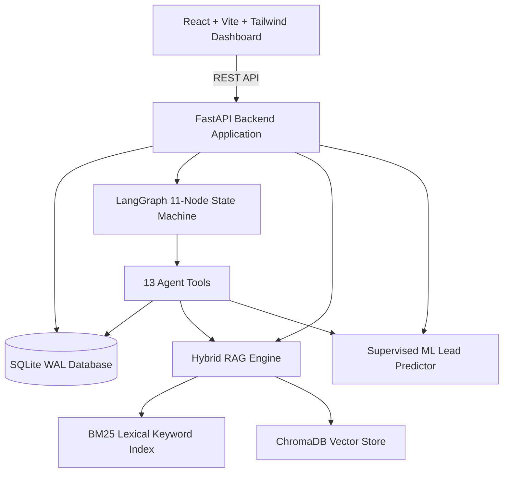

# NexusFlow Sales Intelligence

> **Autonomous B2B Sales Intelligence, Predictive Lead Qualification, and Hybrid RAG Workflow Engine**

NexusFlow is a full-stack, enterprise-grade revenue orchestration platform that unifies predictive machine learning, dense/sparse hybrid document retrieval (RAG), and a 11-node LangGraph autonomous sales workflow agent with human-in-the-loop governance.

---

## Architecture Overview



### Core Capabilities
1. **Predictive Conversion Modeling**: Scikit-Learn RandomForest and LogisticRegression classifiers trained on historical lead conversions with feature importance attribution.
2. **Multi-Criteria Lead Scoring**: Configurable heuristic scoring balancing digital engagement, budget fit, timeline urgency, decision maker authority, and product alignment.
3. **Hybrid RAG Knowledge Base**: Reciprocal Rank Fusion (RRF $k=60$) combining ChromaDB sentence-transformers dense embeddings with rank-bm25 lexical token matching across 14 authoritative knowledge documents.
4. **LangGraph SDR State Graph**: 11-node state graph orchestrating validation, context synthesis, ML scoring, objection retrieval, personalized drafting, contact frequency checks, and managerial approval gates.
5. **Human-in-the-Loop Follow-Up Center**: Approval inbox with draft editing, managerial feedback, and simulated message dispatch sandbox.
6. **Executive Analytics & Benchmarking**: Real-time pipeline funnels, win-rate trends, confusion matrices, and automated retrieval benchmarks.

---

## Directory Structure

```
sales_project/
├── README.md
├── .env.example
├── .gitignore
├── docker-compose.yml
├── docs/
│   ├── architecture.md
│   ├── rag_pipeline.md
│   ├── agent_workflow.md
│   ├── evaluation.md
│   └── setup_guide.md
├── data/
│   ├── synthetic/           # 700 generated leads and 3,431 interactions
│   ├── knowledge_base/      # 14 Markdown company collateral documents
│   └── evaluation/          # Ground-truth retrieval benchmark suite
├── artifacts/
│   ├── lead_model.joblib    # Trained ML pipeline
│   ├── preprocessor_meta.json
│   ├── confusion_matrix.json
│   └── feature_importance.json
├── backend/
│   ├── requirements.txt
│   ├── app/
│   │   ├── main.py          # FastAPI application entrypoint
│   │   ├── config.py        # Pydantic v2 application settings
│   │   ├── api/routes/      # 9 modular route routers
│   │   ├── db/              # SQLAlchemy 2.0 SQLite WAL database
│   │   ├── models/          # SQLAlchemy mapped ORM models
│   │   ├── schemas/         # Pydantic validation schemas
│   │   ├── services/        # Scoring, ML, RAG, Follow-Up, Analytics services
│   │   ├── agents/          # LangGraph state, 13 tools, prompts, nodes, routing
│   │   └── evaluation/      # Comprehensive benchmark evaluator
│   ├── scripts/
│   │   ├── seed_data.py     # Synthetic data generator & DB seeder
│   │   ├── train_model.py   # Cross-validated ML training pipeline
│   │   ├── ingest_knowledge.py # Multi-format document parser & Chroma indexer
│   │   └── run_evaluation.py   # Benchmark runner
│   └── tests/               # 13 passed Pytest test suites
└── frontend/
    ├── index.html
    ├── vite.config.ts
    ├── tailwind.config.js
    └── src/
        ├── api/client.ts    # Axios REST client
        ├── components/      # MetricCards, Badges, Modals, Pagination, Nav
        └── pages/           # All 8 interactive application views
```

---

## Quickstart Guide (Windows / PowerShell)

### 1. Prerequisites
- Python 3.11+
- Node.js 18+ and npm 9+

### 2. Backend Setup
In a PowerShell terminal:

```powershell
# Navigate to backend
cd backend

# Install dependencies
pip install -r requirements.txt

# Seed synthetic leads and interactions into SQLite
python scripts/seed_data.py

# Train the lead conversion prediction model
python scripts/train_model.py

# Ingest all 14 knowledge base documents into ChromaDB
python scripts/ingest_knowledge.py

# Run the test suite (13 passing tests)
python -m pytest

# Start the FastAPI backend server
python -m uvicorn app.main:app --reload --port 8000
```

Backend API will be running at: `http://localhost:8000`  
Interactive Swagger docs: `http://localhost:8000/docs`

---

### 3. Frontend Setup
In a second PowerShell terminal:

```powershell
# Navigate to frontend
cd frontend

# Install node modules
npm install

# Start the Vite development server
npm run dev
```

Frontend application will be accessible at: `http://localhost:5173`

---

## Application Views

| Page | Path | Capabilities |
| :--- | :--- | :--- |
| **Dashboard** | `/` | 6 KPI metric cards, stage funnel, source distribution, 6-mo conversion trend, recent activity |
| **Leads & Pipeline** | `/leads` | Filterable and searchable paginated leads table, sorting, CSV import modal, new lead modal |
| **Lead Detail** | `/leads/:id` | 3-column view: commercial info, interaction timeline, AI analysis trigger, grounded draft review |
| **Agent Activity** | `/agent-runs` | Visual 11-node state graph diagram, execution history, granular millisecond step trace inspector |
| **Follow-Up Center** | `/follow-ups` | Filter tabs (Pending, Approved, Sent, Rejected), inline copy editing, simulation dispatch |
| **Knowledge Base** | `/knowledge` | Document cards, drag-and-drop document upload, live hybrid RRF search test playground |
| **Model Evaluation** | `/evaluation` | ML metrics (Acc, F1, ROC-AUC), 2x2 confusion matrix, RAG recall@5, feature importance bar chart |
| **Settings** | `/settings` | LLM toggle (Demo vs OpenAI), weight sliders, priority thresholds, database reset |

---

## Testing & Verification

Run the automated test suite covering ML prediction, heuristic priority calculation, ChromaDB hybrid search, LangGraph state machine execution, and all REST endpoints:

```powershell
cd backend
python -m pytest
```

Expected result: `13 passed, 0 failed`.
