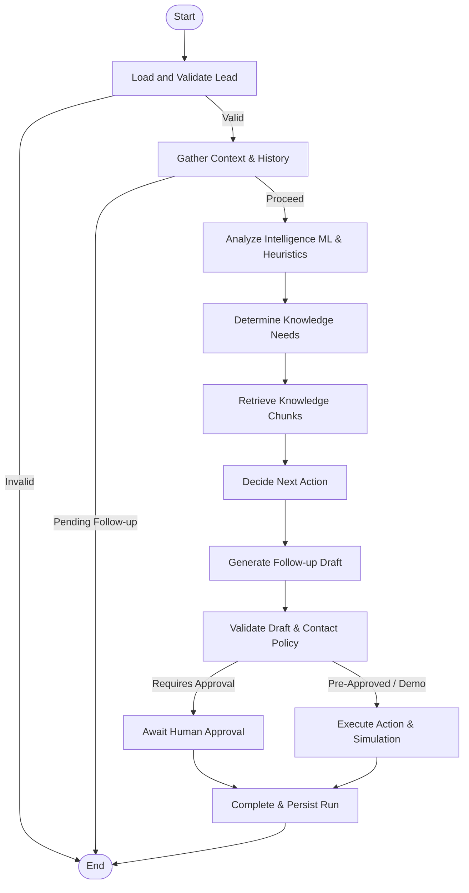

# NexusFlow Agent Workflow

## LangGraph StateGraph Architecture
The agent automates SDR lead qualification and follow-up generation using an 11-node directed graph.

## Node Responsibilities
1. `load_lead`: Queries lead database and validates current status.
2. `gather_context`: Collects past interactions, previous analyses, active drafts.
3. `analyze_intelligence`: Calculates priority score & conversion probability.
4. `determine_retrieval`: Extracts search queries from lead pain points.
5. `retrieve_kb`: Executes hybrid search against Knowledge Base.
6. `decide_action`: Recommends next sales action with clear rationale.
7. `generate_draft`: Crafts personalized email or LinkedIn draft grounded in RAG sources.
8. `validate_output`: Checks schema integrity, contact frequency policy, and approval flags.
9. `human_approval`: Gates sending behind sales manager confirmation.
10. `execute_action`: Logs interaction and updates draft state.
11. `complete_persist`: Computes run duration, records step traces, persists telemetry.
