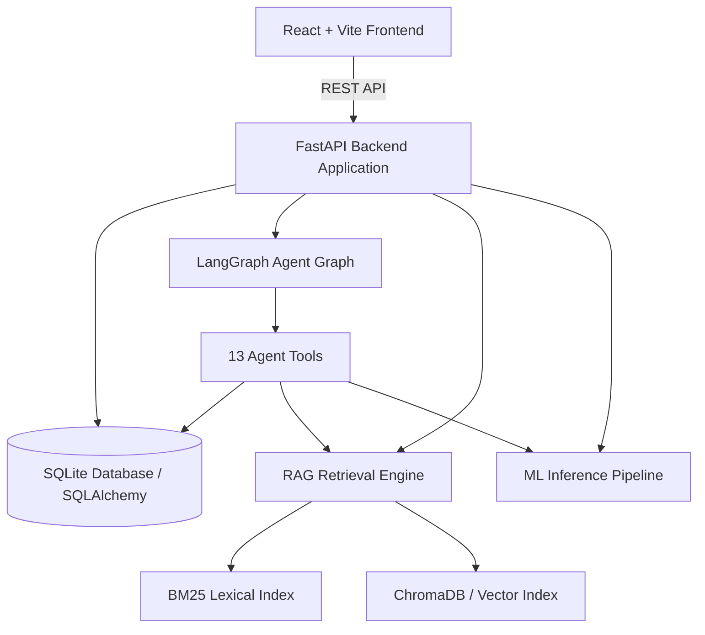

# NexusFlow Sales Intelligence Architecture

## Overview
NexusFlow Sales Intelligence is an end-to-end B2B sales automation platform integrating:
- Machine Learning lead conversion prediction
- Weighted heuristic priority scoring
- Retrieval-Augmented Generation (RAG) over knowledge bases
- LangGraph-orchestrated autonomous sales workflow agent with human-in-the-loop review
- Modern React + TypeScript + Tailwind analytics dashboard

## System Components
1. **Core API**: FastAPI routing for Leads, Analyses, Agent Runs, Follow-Ups, Knowledge, Analytics, Evaluation, Settings.
2. **Database Engine**: SQLAlchemy 2.0 with WAL-mode SQLite concurrency for atomic transactions.
3. **Machine Learning Pipeline**: Scikit-Learn RandomForest & LogisticRegression classifiers predicting conversion probability with feature importance attribution.
4. **Hybrid RAG Pipeline**: Reciprocal Rank Fusion (RRF) combining dense semantic search (sentence-transformers / TF-IDF fallback) and sparse BM25 indexing.
5. **Agentic Workflow**: LangGraph 11-node state graph implementing automated intelligence analysis, context synthesis, objection retrieval, personalized drafting, policy validation, and human approval gates.
